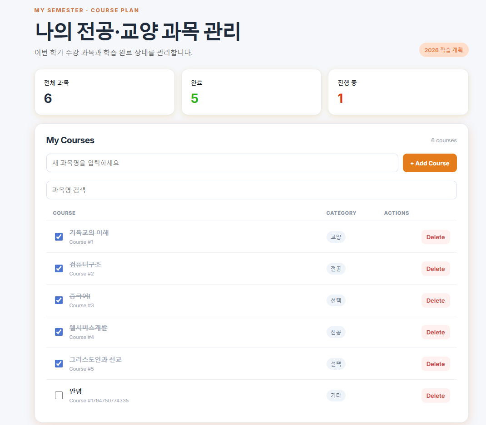
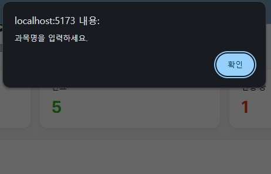

Project Information: 
프로젝트 소개
- 수강 과목을 확인하고 관리하는 REact. 과목 등록 및 삭제기능 지원/완료여부 체크가능/검색기능 지원

실행방법

Project URL : https://github.com/2026-2-OSS/assign11-c02-22500693

Installation: 설치·실행 방법 및 실행 화면
npm.cmd install
npm.cmd run dev

Source Code Exploration: 주요 파일 3개, Component와 Props 관계, useState 및 Event 분석, 주요 코드 2개 설명

APP.jsx : 페이지 제목 및 화면 구성담당 jsx파일
CourseList.jsx : 과목정보 및 등록/삭제/완료/검색 관ㄹ;
CourseItem.jsx : 과목정보를 표시하고 버튼이벤트 담당

Courselist가 course, onDelete, onToggle을 CourseItem에 전달하고, useState로 목록을 관리한다. 

삭제기능은 filter함수를 사용했고, 완료상태는 map을 사용했다

Customizing: 수정한 데이터, 텍스트, 스타일 및 파일명
과목명을 한국어로 바꾸고, 카테고리 도 변경한 뒤, 제목과 CSS를 조금 건드렸다. 
App.css

Feature Extension: 구현한 기능 2개 이상, 주요 코드 및 동작 결과

과목등록 / 완료상태(체크박스) /과목검색 / 과목삭제

Deployment: https://2026-oss-assign11-ebon.vercel.app/

Weekly Review:
새롭게 배운 내용 3가지
1. Props 전달방법, 
2. UseState사용방법
3. map과 filter 사용방법

어려웠던 점과 해결 방법
- 월요일수업참여를 안해서 이해에 어려움이 있었음
- 해결방법은 아래 AI활용으로 이어짐

AI 활용 내용 및 느낀 점
- PPT를 AI한테 넣고 설명해달라고 요구함. 
- 진도가너무빨라요교수님 으아악